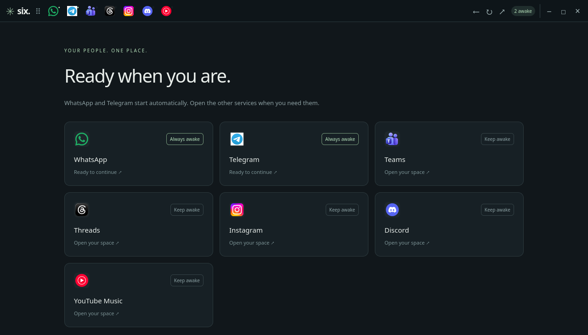

# Six

Your messaging services in one quiet home. Six is a small Linux desktop app that puts Discord, WhatsApp, Threads, Instagram, Teams, Telegram and YouTube Music side by side as compact tabs, and keeps them light on memory and CPU.



*The home screen, shown with sample data. Services you have not opened yet say "Open your space".*

## Services

| Service | Address | Notes |
|---|---|---|
| WhatsApp | web.whatsapp.com | Starts with Six and never sleeps |
| Telegram | web.telegram.org | Starts with Six and never sleeps; a **Latest ↓** button jumps to the newest messages |
| Teams | teams.microsoft.com | Microphone, camera and screen sharing for calls |
| Threads | threads.com | |
| Instagram | instagram.com | |
| Discord | discord.com | |
| YouTube Music | music.youtube.com | Plays protected tracks; ads are removed |

Each service has its own saved login, kept separate from the others.

## Light on resources

- **Starts small.** Only WhatsApp and Telegram load at startup, including when Six starts hidden in the tray. The others load when you open them.
- **Pauses what you are not using.** A service you have not used for 5 minutes is paused: its page and drafts stay in memory, but background work stops.
- **Frees memory.** After 5 more minutes (10 in total) a paused service is closed to give its memory back. It reloads when you open it again, and you stay signed in.
- **Never closed:** WhatsApp, Telegram, services you set to **Keep awake**, services with a sign-in popup open, calls, and anything playing audio.
- **Capped cache.** Each service's web cache is limited to 256 MB.
- **Quiet in the tray.** Closing the window keeps Six running in the tray. Six stops refreshing its own screen while hidden.
- **Hardware video.** Video decoding and encoding run on the graphics chip through VA-API (on Intel, install `intel-media-va-driver`). If video glitches or shows black frames, add `"_hardwareVideo":false` to `~/.config/Six/settings.json` and restart Six.
- **Self-healing.** If an always-awake, pinned or open service crashes, Six restarts it, up to 3 times in 10 minutes.

The memory figure on the home screen adds up the working sets of all Six processes. Shared memory can be counted more than once, so it is an estimate, not an exact footprint.

## Notifications and sound

- With a service open, **Alerts on/off** controls its desktop notifications, and **Sound on / Muted** controls all of its audio, including call audio.
- The tray menu has **Pause all notifications**, **Mute all audio** and **Block ads and trackers**. A global setting overrides the per-service one.
- A paused or closed service cannot deliver notifications. Set a service to **Keep awake** if you need its alerts or calls.
- Some sites ask for a notification to stay on screen until you click it. Six removes that request and also closes such a notification after 5 seconds. Ordinary notifications are not touched.

## Ads, scrollbars and menus

- **Ad and tracker blocking.** Requests to known ad and tracking servers are blocked using [Peter Lowe's list](https://pgl.yoyo.org/adservers/) (bundled in `adblock-hosts.txt`, about 3,500 hosts). Pages you open are never blocked, only what they load. Switch it off from the tray menu. The hosts blocked for each service are written to `~/.config/Six/adblock-blocked.txt`; if a page breaks, find its host there and remove it from `adblock-hosts.txt`.
- **YouTube Music ads.** While blocking is on, the YouTube Music tab strips ad slots from YouTube's player data before playback. An ad that still gets through is muted, run to its end and skipped. YouTube changes its player often, so this can stop working until it is updated. Ads that a site serves from its own servers, such as sponsored posts in Threads, are not removed.
- **Hidden scrollbars.** Scrollbars are hidden everywhere; scrolling with the wheel, touchpad and keyboard still works.
- **Right-click menu.** Spelling suggestions, open or copy a link, copy an image, and undo, redo, cut, copy, paste, paste as plain text and select all.

## Teams calls

Teams microphone, camera and speaker-selection permissions are allowed automatically on official Teams HTTPS addresses. Teams audio starts unmuted unless global mute is on. Nothing joins a call or switches on your camera by itself.

Screen sharing opens a chooser for the screen or window, with an **Include system audio** option. Linux audio capture and publishing into a Teams meeting still need a full test in a real meeting.

To avoid dropping a call, Six watches only whether a call is active (a yes or no from WebRTC and live media tracks, including muted ones). It does not read, record or send call contents. Teams stays awake during calls and sharing, and for 5 idle minutes after they end.

## YouTube Music and sign-in

Six runs on [castlabs' Electron build](https://github.com/castlabs/electron-releases) (`44.9.3+wvcus`), which includes Widevine, so YouTube Music can play protected tracks. Widevine is only granted to YouTube's HTTPS pages for that tab, and it downloads the first time Six starts.

Google rejects sign-in from many embedded apps. On `accounts.google.com` and `accounts.youtube.com` Six presents a plain browser identity so the sign-in goes through.

## Security

- Service pages run in sandboxed renderers with context isolation and web security on, and have no Node access.
- Each service has its own stored session. Six never handles your passwords itself.
- Camera and microphone requests ask for approval (except on Teams addresses, above). Other device permissions are denied.
- Sign-in popups from trusted domains open inside Six, in a sandbox that shares the service's session. Other links open in your system browser.
- Teams and YouTube Music add small page scripts for call status and ad removal, and every service gets one for notifications. They do nothing else.

## Run it

Requires Node 22.12 or newer, on Linux (built and used on Ubuntu with GNOME and Wayland).

```bash
npm install
node node_modules/electron/install.js
npm test      # run the tests
npm start     # start Six
```

To install a copy system-wide, `install-update.sh` copies the app into `/opt/six-messenger` and keeps a small rollback copy of the previous files in a `.rollback-<date>` folder. Run it as your normal user; it asks for your password. Start Six from the app menu afterwards.

## What is where

| File | Purpose |
|---|---|
| `main.js` | App window, tray, service views, sleeping and closing, permissions |
| `policy.js` | The service list and the sleep and close rules |
| `adblock.js`, `adblock-hosts.txt` | Ad and tracker blocking |
| `notification-policy.js` | Notification, audio and popup rules, Google sign-in identity |
| `notification-preload.js`, `notification-sw-preload.js` | Auto-hide for notifications that stay on screen |
| `teams-call-preload.js`, `screen-sharing.js`, `media-policy.js` | Teams calls and screen sharing, Widevine for YouTube |
| `ytmusic-preload.js` | YouTube Music ad removal |
| `context-menu.js`, `content-style.js` | Right-click menu and page styling |
| `*.test.js` | Tests, run with `npm test` |
